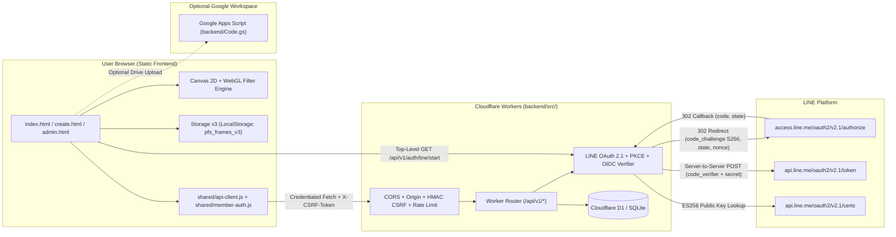

# System Architecture — Bunludham Photo Frame Studio & LINE Login Membership

## 1. Architectural Overview

`bunludham` combines a **zero-build Vanilla HTML5/CSS3/JavaScript static frontend** (compatible with GitHub Pages at `/bunludham/` or any static host) with a **production-oriented Cloudflare Workers + D1 (SQLite) backend API** for official **LINE Login v2.1 + OpenID Connect** authentication, opaque session management, member profile customization, and PDPA-aligned consent tracking.

Crucially, **public frame selection, WebGL/Canvas 2D photo editing, color filters, quote overlays, and direct PNG downloading remain 100% functional without logging in and even when the backend API is offline**.



---

## 2. Repository Layout & Symlink Notes

```text
bunludham/
├── index.html                 # Main Photo Frame Studio + Community Wall + LINE Login
├── create.html                # Dedicated 3-Frame Kathin 118 User Studio + LINE Login
├── user.html                  # Redirect helper -> create.html
├── admin.html                 # LocalStorage Frame/Quote/Moderation Admin + Backup v3
├── test_runner.html           # In-browser Visual QA & Storage v3 Regression Suite (16 tests)
├── config.js                  # Public runtime config (gasWebAppUrl, apiBaseUrl, policyVersion)
├── app.js / create.js / admin.js / style.css / admin.css
├── shared/
│   ├── storage.js             # Canonical Storage v3 Engine, v2->v3 Migration, Backup & Sync
│   ├── image-filter.js        # WebGL + Canvas 2D Image Filter Pipeline
│   ├── drive-sync.js          # Optional Google Apps Script Upload Client
│   ├── api-client.js          # Credentialed Membership API Client (in-memory CSRF token)
│   └── member-auth.js         # Thai LINE Login Button, Profile/Consent Modal & Session UX
├── frontend/ & admin/         # Legacy convenience symlinks (GitHub Pages serves from repo root `/`)
├── backend/
│   ├── Code.gs                # Preserved Google Apps Script for optional Google Drive archiving
│   ├── package.json           # Zero-external-dependency ES Module scripts (dev, test, migrate)
│   ├── wrangler.toml          # Cloudflare Workers + D1 config (dev, staging, production)
│   ├── .dev.vars.example      # Local secret template (never committed as .dev.vars)
│   ├── migrations/            # Versioned SQLite / D1 schema migrations
│   ├── seeds/                 # Development-only seed SQL
│   ├── scripts/               # Local Node HTTP dev server & migration CLI
│   ├── src/                   # Modular Cloudflare Worker source
│   └── tests/                 # Automated Node test suite (Storage v3, DB, OAuth, API, UI)
└── docs/                      # Engineering, Security, Setup & Deployment Documentation
```

> **Note on `frontend/` and `admin/` symlinks**: GitHub Pages deploys from the repository root (`/`) using `index.html`, `create.html`, `user.html`, and `admin.html`. Existing symlinks inside `frontend/` and `admin/` are preserved for backward compatibility, while root HTML entrypoints remain canonical because relative paths to `assets/` and `shared/` resolve from `/`.

---

## 3. Key Design Decisions

1. **Zero Runtime NPM Dependencies in `backend/`**: Built purely on Web Platform standard APIs (`fetch`, `Request`, `Response`, `URL`, `crypto.subtle`) for the Cloudflare Worker runtime and Node's built-in `node:sqlite`, `node:http`, and `node:test` (`Node >= 22.5`) for local development and CI testing.
2. **Decoupled Internal `member_id`**: External LINE `sub` identifiers are stored strictly in `auth_identities(provider, provider_subject)` and mapped to internal `mem_...` IDs in `members`, preventing provider lock-in and avoiding exposure of raw LINE user IDs across internal APIs.
3. **Opaque Server-Managed Sessions**: Sessions use 256-bit random tokens delivered via `HttpOnly` cookies (`pfs_session`) with only `SHA-256(token)` persisted in `sessions`, enabling immediate server-side revocation and session rotation on login.
4. **Coexistence with `backend/Code.gs`**: `backend/Code.gs` remains untouched at its exact path so the Admin panel's one-click Google Apps Script copy workflow continues to function seamlessly.
