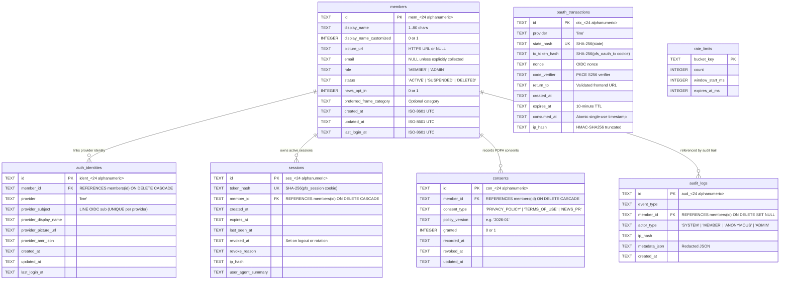

# Database Schema & Migrations (Cloudflare D1 / SQLite)

Migration files live in [`backend/migrations/`](../backend/migrations/) and are tracked with SHA-256 checksums in `schema_migrations`.

---

## 1. Entity-Relationship Diagram



---

## 2. Constraints & Indexes

- **`auth_identities`**: `UNIQUE(provider, provider_subject)` guarantees one LINE user (`sub`) can never accidentally create duplicate member accounts; `idx_auth_identities_member_id` indexes lookups by `member_id`.
- **`sessions`**: `token_hash` is `UNIQUE` (raw session tokens are never stored); indexed on `member_id` and `expires_at`.
- **`oauth_transactions`**: `state_hash` is `UNIQUE`; indexed on `expires_at` for automatic cleanup.
- **`consents`**: `UNIQUE(member_id, consent_type)` maintains one canonical current consent row per consent type while preserving `recorded_at` and `revoked_at` timestamps.
- **`audit_logs`**: Uses `ON DELETE SET NULL` for `member_id` so security audit records survive member deletion without dangling foreign keys.

---

## 3. Running Migrations & Seeds

### Local SQLite (`backend/.local/dev.sqlite`)
```bash
# Apply pending migrations (idempotent + checksum verified)
npm --prefix backend run db:migrate

# Apply migrations + development sample seed (blocked automatically if APP_ENV=production)
npm --prefix backend run db:seed
```

### Cloudflare D1
```bash
# Local Wrangler D1
npm --prefix backend run cf:d1:migrate:local

# Remote Staging / Production D1
npm --prefix backend run cf:d1:migrate:staging
npm --prefix backend run cf:d1:migrate:production
```
